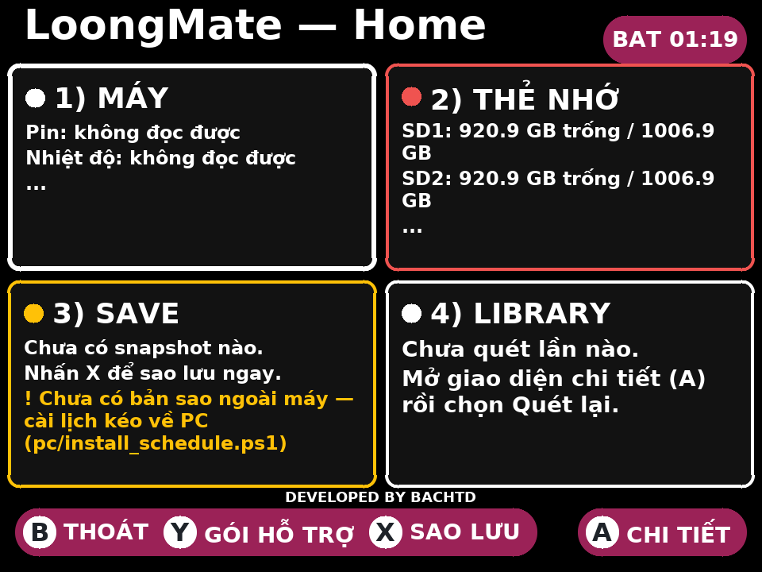
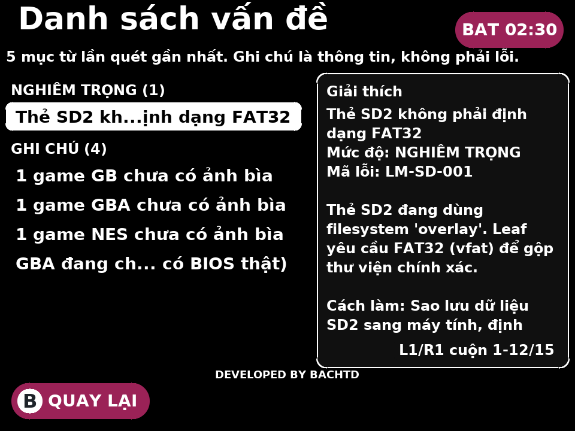
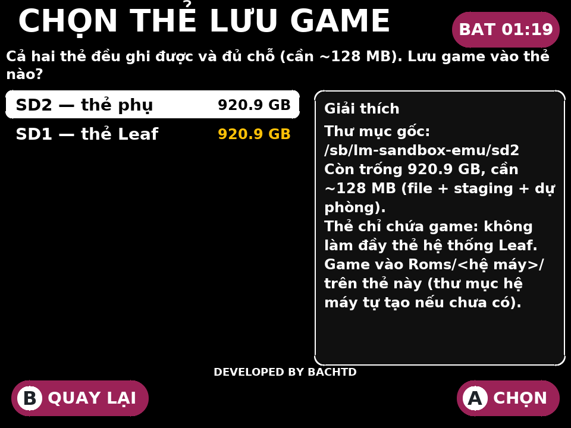

# LoongMate

Ứng dụng bảo vệ, chẩn đoán và phục hồi cho **Miniloong Pocket 1** chạy **Leaf**: giữ save an toàn, tìm và sửa lỗi thư viện
(kể cả game Leaf không hiện), giữ cấu hình RetroArch qua các lần cập nhật Leaf, dịch game sang tiếng Việt. Chạy ngay trên máy,
điều khiển bằng nút, không cần máy tính hay dòng lệnh.

LoongMate là **phần mềm miễn phí (freeware)**: chỉ phát hành bản dựng sẵn, không phát hành mã nguồn. *English summary below.*

| Màn chính | Danh sách vấn đề | Chọn thẻ lưu game |
| --- | --- | --- |
|  |  |  |

## LoongMate làm gì

- **Save an toàn**: sao lưu save/state của cả hai thẻ (tự động sau mỗi lần thoát game khi bật Agent), khôi phục từng game,
  tự sao lưu hiện trạng trước khi ghi, từ chối khi game còn chạy.
- **Thư viện đúng như Leaf thấy**: đối chiếu với danh mục hệ máy của chính bản Leaf đang cài, báo game Leaf không hiện
  (ví dụ CPS1/2/3 ngoài thư mục ARCADE), ảnh bìa lệch tên, `.cue` hỏng, đĩa thiếu `.m3u`, ROM trùng giữa hai thẻ, BIOS.
  Sửa có xem trước và **Hoàn tác**.
- **Thêm game an toàn**: Nhập game từ `Import/` (cả .zip/.7z/.rar), Tải từ web (https, tải tiếp khi mất mạng, gắn ảnh bìa),
  Homebrew Hub (chỉ game có giấy phép rõ), thư viện riêng trên PC/NAS qua [PocketBridge](docs/POCKETBRIDGE.md). Hỏi lưu vào SD1 hay SD2.
- **Cấu hình Leaf**: sao lưu `retroarch.cfg`, override, remap, core option; so từng khoá trước/sau cập nhật Leaf.
- **Dịch game** (thử nghiệm): lớp phủ tiếng Việt khi chơi (AI bằng API key của bạn, hoặc gói offline), và **Việt hoá cá nhân**
  cho game GB/GBC/GBA (dịch AI hoặc Google, dời / ngắt dòng / rút gọn câu dài, dấu phủ tiếng Việt): chữ Việt nằm ngay trong game,
  dựng trong RAM, chỉ dùng được trên máy của bạn. Xem [docs/DICH-GAME.md](docs/DICH-GAME.md) và
  [danh sách game đã kiểm](docs/DANH-SACH-GAME.md).
- **Tua nhanh**: gán Menu + R1 (hoặc L1) bật/tắt tua nhanh trong game, tốc độ 2x/3x/4x/tối đa.
- **Tự tiếp tục** chỗ đang chơi khi mở game từ Games/Favorites, không vá file nào của Leaf; kèm [Leaf Hot Tabs](docs/HOT-TABS.md).
- **Khoá khi thức dậy**: để máy trong túi không tự lướt menu, mở game; giữ Select + Start 1 giây để mở.

## Cài đặt

1. Tải `LoongMate-AllInOne.zip` ở mục [Releases](../../releases).
2. Tắt máy, cắm thẻ chứa Leaf vào máy tính, chép **nội dung** thư mục `THE-NHO` vào gốc thẻ (gộp với `Apps` có sẵn).
3. Bật máy, mở **Apps → LoongMate**. Lần đầu app tự cài Python đi kèm (khoảng 3 giây).
4. Nên bật **Settings → Services → LoongMate Agent** (*Start with Leaf* + *Run*).

Hướng dẫn chi tiết nằm trong file `DOC-TRUOC.txt` của gói. Cập nhật Leaf không xoá LoongMate.
Gỡ: xoá `Apps/mlp1/LoongMate.pak` và `Apps/mlp1/LoongMateAgent.pak`.

## Nguyên tắc an toàn

- Không sửa kernel, bootloader, phân vùng hệ thống hay file của Leaf.
- Không tự xoá file: file bị thay hoặc dọn đi vào `Quarantine/`; sửa hàng loạt có nhật ký và Hoàn tác.
- Mọi thay đổi có bước xem trước và hộp xác nhận mặc định *Huỷ*.
- Thẻ FAT32 và mất điện đột ngột vẫn có rủi ro: hãy giữ một bản sao save ngoài máy.

## Nội dung và bản quyền

LoongMate **không** kèm, không tải và không chỉ đường tới ROM hay BIOS thương mại. Tải từ web là trình tải chung cho
link bạn tự đưa vào; nó không chạy JavaScript và không vượt quảng cáo, đếm ngược hay captcha. Chỉ tải và nhập nội dung
bạn có quyền sử dụng. BIOS phải do bạn tự trích từ máy của mình.

Bản Việt hoá cá nhân chỉ dùng trên máy đã tạo ra nó, không sửa game gốc, không xuất ra được. **Không mua bán, không xin
donate bằng bản Việt hoá**; hãy tôn trọng quyền sở hữu trí tuệ của nhà phát hành game.

## Miễn trừ trách nhiệm

- LoongMate là phần mềm miễn phí, **không kèm và không phân phối ROM**; người dùng tự dùng ROM mình sở hữu hợp pháp.
- Bản Việt hoá **chỉ dựng trong RAM, khoá theo từng máy, không xuất được**. **Cấm chia sẻ hoặc buôn bán** ROM / bản Việt hoá.
  Tên game và thương hiệu thuộc chủ sở hữu tương ứng.
- Phần mềm cung cấp **"nguyên trạng"**, không bảo hành; tác giả không chịu trách nhiệm về hỏng save, hỏng dữ liệu hay việc
  sử dụng sai mục đích.
- Nên **sao lưu save** trước khi dùng; bản dịch do máy tạo nên **có thể sai nghĩa**.

## Báo lỗi, đề xuất

Mở [GitHub Issues](https://github.com/Bachtd1/Loongmate/issues) hoặc nhắn trực tiếp cho tác giả. Với game Việt hoá báo
"rất khó" (chữ nén/mã hoá riêng), hãy ghi tên game chính xác (tên file ROM) để được xem xét.

## Tài liệu

| Tài liệu | Nội dung |
| --- | --- |
| [docs/PHAT-HANH-0.5.1.md](docs/PHAT-HANH-0.5.1.md) | Ghi chú phát hành 0.5.1-beta: sửa 7 game Việt hoá, 573/573 ROM chạy |
| [docs/POCKETBRIDGE.md](docs/POCKETBRIDGE.md) | Thư viện game riêng qua PocketBridge + Tailscale: cài agent, ghép đôi, đường dẫn |
| [docs/HOT-TABS.md](docs/HOT-TABS.md) | Leaf Hot Tabs (tự tiếp tục game): chọn đúng bản theo phiên bản Leaf |
| [docs/PHAT-HANH-0.5.0.md](docs/PHAT-HANH-0.5.0.md) | Ghi chú phát hành 0.5.0-beta: đã làm được, còn chờ nâng cấp, miễn trừ |
| [docs/DANH-SACH-GAME.md](docs/DANH-SACH-GAME.md) | Game đã kiểm Việt hoá: chạy tốt / kiểm tự động / còn lỗi |
| [docs/GIOI-THIEU-DICH-GAME.md](docs/GIOI-THIEU-DICH-GAME.md) | Giới thiệu Dịch game: cách dùng chi tiết, hạn chế, hướng sắp tới |
| [docs/DICH-GAME.md](docs/DICH-GAME.md) | Dịch game, Việt hoá cá nhân, API key |
| [docs/MA-LOI.md](docs/MA-LOI.md) | Mã lỗi `LM-…` và cách xử lý |
| [COMPATIBILITY.md](COMPATIBILITY.md) | Phiên bản Leaf và tính năng đã kiểm |
| [PRIVACY.md](PRIVACY.md) | App dùng mạng khi nào, gói hỗ trợ chứa gì |
| [SECURITY.md](SECURITY.md) | Báo lỗ hổng bảo mật |
| [CHANGELOG.md](CHANGELOG.md) | Thay đổi theo phiên bản |
| [LICENSE](LICENSE) | Điều khoản sử dụng (freeware) |

Phát triển bởi **BACHTD**.

---

## English

**LoongMate** is an on-device protection, diagnostics and recovery app for the **Miniloong Pocket 1** running the
**Leaf** custom firmware. It runs as a regular app from Leaf's Apps tab, is fully button-driven, and never modifies
Leaf's own files. LoongMate is **freeware**: only prebuilt releases are published, the source code is not.

- **Saves**: incremental snapshots of saves/states on both SD cards (automatic after each game with the Agent service),
  per-game restore with a pre-restore backup; restores are refused while an emulator is running.
- **Library Doctor**: checks your library against the system catalog of the Leaf version you actually run (games Leaf
  will not show, misnamed cover art, broken `.cue` files, missing `.m3u`, duplicates across cards, BIOS). Fixes are
  previewed and can be undone.
- **Adding games**: import from `Import/` (zip/7z/rar), HTTPS downloads with resume, licensed homebrew, your own PC/NAS library.
- **Game translation** (experimental): Vietnamese overlay while playing, and a personal Vietnamese patch for GB/GBC/GBA
  games that only works on the device that created it.
- **Leaf config backup**, **resume from Games/Favorites**, **pocket lock**, **fast forward hotkey** (Menu + R1).

Install: download `LoongMate-AllInOne.zip` from Releases, copy the contents of `THE-NHO` to the root of your Leaf SD card,
then open **Apps → LoongMate**. The bundled Python runtime unpacks itself on first launch.

LoongMate ships no ROMs or BIOS files and does not bypass ads, countdowns or captchas. Only download and import content
you are entitled to use. Translated games are built in RAM, locked to your device and cannot be exported; sharing or
selling ROMs or translations is prohibited. Provided "as is" without warranty; back up your saves. Report problems via GitHub Issues.
Free for personal use; see [LICENSE](LICENSE). Developed by **BACHTD**.
